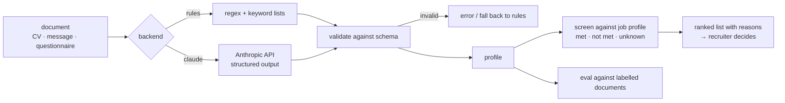

# cv-screening-assistant

[](https://github.com/nikita-automation/cv-screening-assistant/actions/workflows/ci.yml)

Turns CVs, cover messages and applicant questionnaires (German or English, plain text) into a **structured
profile** — skills, forklift and driving licences, place of residence, languages with level, shift
availability, salary expectation — and compares profiles with a vacancy's requirements, **explaining every
verdict**.

Two interchangeable extraction backends behind one schema:

| Backend | What it is | Strengths | Weaknesses |
|---|---|---|---|
| `rules` | regular expressions + keyword lists, standard library only | offline, free, instant, deterministic, respects negations | breaks on paraphrases and unusual layouts |
| `claude` | the Anthropic API with structured output, response validated locally | handles paraphrases and layouts | needs credentials, costs money, answer must be validated |

And an **evaluation harness** that scores either backend against hand-labelled documents — so "is the AI
better?" is a number, not a feeling.

> **Independent demo.** All people, documents and numbers in this repository are fictional (phone numbers use
> ranges reserved for fiction, e-mail addresses use `example.*`). The code was written from scratch as a
> reference implementation of a generic problem and is not derived from any company's system or data.

## Quick start

```bash
git clone https://github.com/nikita-automation/cv-screening-assistant
cd cv-screening-assistant
export PYTHONPATH=src
python3 -m cvscreen extract data/sample/documents/03_clara_questionnaire_de.txt
python3 -m cvscreen eval
python3 -m cvscreen screen data/sample/documents
```

Python 3.9+ for everything except the live `claude` backend (the `anthropic` package needs Python 3.10+).

```json
{
  "name": "Clara Müller", "email": "clara.mueller@example.org", "phone": "+493023125003",
  "postal_code": "44787", "city": "Bochum",
  "languages": [{"language": "German", "level": "C1"}, {"language": "Russian", "level": "native"}],
  "driving_licence": ["B"], "forklift_licence": false,
  "skills": ["cash handling", "cleaning", "customer service"],
  "shift_available": ["early"], "shift_unavailable": [],
  "salary": {"amount_min": 13.5, "amount_max": 13.5, "unit": "hour", "currency": "EUR"},
  "available_from": "2026-11-15"
}
```



## How good is it? (measured, not claimed)

`python -m cvscreen eval` scores a backend field by field against hand-labelled documents (exact match for
scalars, F1 for lists).

| Set | Documents | `rules` backend |
|---|---|---|
| Development set (`data/sample`) — the rules were written while looking at these | 12 | **96.8 %** |
| **Held-out set** (`data/heldout`) — written *afterwards*, rules not tuned to them | 4 | **73.1 %** on the first run, 75.0 % after fixing the one regex bug it exposed (a city pattern that swallowed the next line) |

The gap is the point. A score on the documents you developed against says little; the honest number is the
second one (and with 4 documents it is a rough indicator, not a statistic). What went wrong on unseen text:

- **Layout the rules don't know:** `Vorname:` / `Nachname:` fields, a questionnaire title mistaken for the name.
- **Vocabulary gaps:** `Gehalt:` without `-vorstellung`, `Eintritt:`, `Hindi`, `car licence`, `mornings and evenings`.
- **Dangerous one, kept on purpose in the tests:** in a Q&A layout, *"Which shifts can you NOT work? Night shifts"*
  reads as night shifts being **available**. The negation sits in the question, the rules look at the answer.

That last class is exactly why the output is a *suggestion*, why unknown never counts as "no", and why the
`claude` backend exists. Run `python -m cvscreen eval --backend claude` (and `--docs data/heldout/documents
--gold data/heldout/gold.json`) with credentials to get the same table for the model — see
[docs/EVALUATION.md](docs/EVALUATION.md). The model backend has **not** been scored in this repository's CI
(no credentials there); its request/response handling is covered by tests with a fake client.

## The `claude` backend

```bash
pip install anthropic            # Python >= 3.10; credentials from ANTHROPIC_API_KEY or `ant auth login`
python -m cvscreen extract data/sample/documents/06_felix_cv_en_hard.txt --backend claude --fallback rules
python -m cvscreen request  data/sample/documents/06_felix_cv_en_hard.txt   # exact request, no network
```

- Structured output (`output_config.format` with the profile's JSON schema) **and** local validation of the
  answer — a model response is untrusted input like any other.
- The document is wrapped as data; the system prompt tells the model to ignore instructions inside it, never to
  guess (null instead), to respect negations and plans ("I want to get a forklift licence" = does not hold one).
- Refusals, truncated answers, invalid JSON and schema violations raise `ExtractionError`; `--fallback rules`
  degrades to the rules backend instead of failing the batch.
- Default model `claude-opus-5-5`, override with `--model` or `$CVSCREEN_MODEL`. No sampling parameters, no
  forced tool use. Server-side refusal fallback (`fallbacks: "default"`) is switched on.

## Screening

```bash
python -m cvscreen screen data/sample/documents --job data/sample/job_profile.json
```

Each requirement of the job profile is judged **met**, **not met** or **unknown**. Missing information is
never treated as a "no":

```
Job: Warehouse operator, late shift (fictional vacancy)

01_anna_cv_de.txt                  qualified      nice-to-have 4/4
05_elif_cv_de.txt                  qualified      nice-to-have 2/4
02_ben_cv_en.txt                   check manually nice-to-have 3/4
    unknown  late shift: not stated
...
03_clara_questionnaire_de.txt      does not meet  nice-to-have 1/4
    not_met  forklift licence: no
```

Requirement types: `forklift_licence`, `languages` (CEFR minimum; `native` passes, non-CEFR labels like
"fluent" go to *check manually*), `shift`, `driving_licence`, `skills`, plus an optional `max_salary` (only
compared when the unit matches). The verdict is a suggestion with reasons for a **recruiter**; it is not an
automated decision about a person (relevant under GDPR Art. 22). Real CVs are personal data — the demo uses
fictional ones only.

## Schema

Defined once in [src/cvscreen/schema.py](src/cvscreen/schema.py), used as the model's JSON schema and as the
validator for every backend's output.

| Field | Meaning |
|---|---|
| `name`, `email`, `phone`, `postal_code`, `city` | contact and place of residence (`null` if absent) |
| `languages` | `[{language, level}]`, level = CEFR `A1`–`C2` or `native`/`fluent`/`good`/`basic` |
| `driving_licence` | classes held, e.g. `["B", "BE"]` |
| `forklift_licence` | `true` / `false` (explicitly none, or only planned) / `null` (not mentioned) |
| `skills` | from a fixed vocabulary (warehouse, order picking, packing, goods receiving, shipping, inventory, customer service, MS Office, SAP, cash handling, cleaning, gastronomy) |
| `shift_available` / `shift_unavailable` | subsets of `early`, `late`, `night`, `weekend`; past experience alone is not availability |
| `salary` | `{amount_min, amount_max, unit: hour/month/year, currency: EUR}` |
| `available_from` | `immediately`, or an ISO date when a full date is given |

## Tests

```bash
PYTHONPATH=src python3 -m unittest discover -s tests
```

69 tests: schema validation, every extraction rule with its boundaries (salary formats and unit guesses, negation
scope, licence formats, date formats), scoring maths, the screening logic, the model backend against a fake client
(request shape, refusal, truncation, invalid JSON, schema violations), the CLI, and regression guards on both
labelled sets. The suite was mutation-checked: flipping individual comparisons in the rules, schema, scorer,
screener and model backend makes tests fail (and the checks found real bugs — a name pattern that ran across lines, a language matcher that
skipped a language after another one — plus a dead code path and several untested boundaries).

## Limitations

- Plain text only — PDFs and scans need a text-extraction step in front (e.g. `pdftotext`, OCR).
- The skills vocabulary is small and fixed; the language list covers 11 languages.
- The rules backend's salary, date and name logic is heuristic (see the held-out results above).
- The held-out set has 4 documents; treat its score as an indication.
- The model backend is untested against the live API in this repository.

## License

MIT — see [LICENSE](LICENSE).
